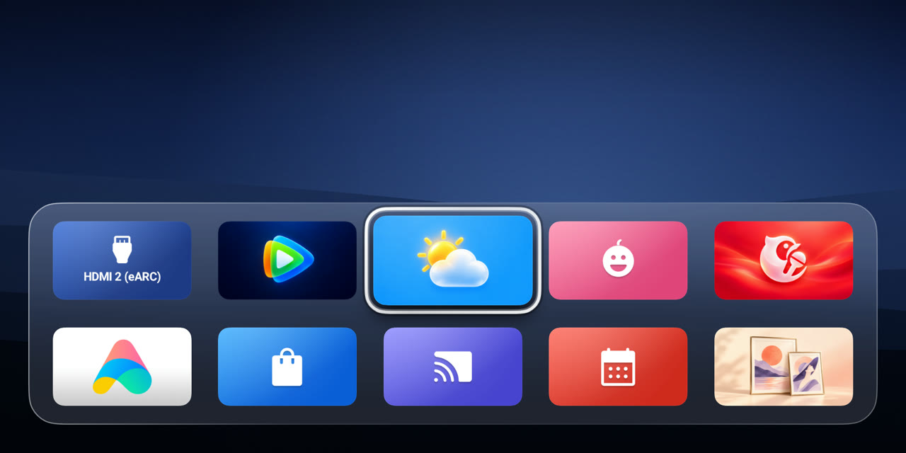
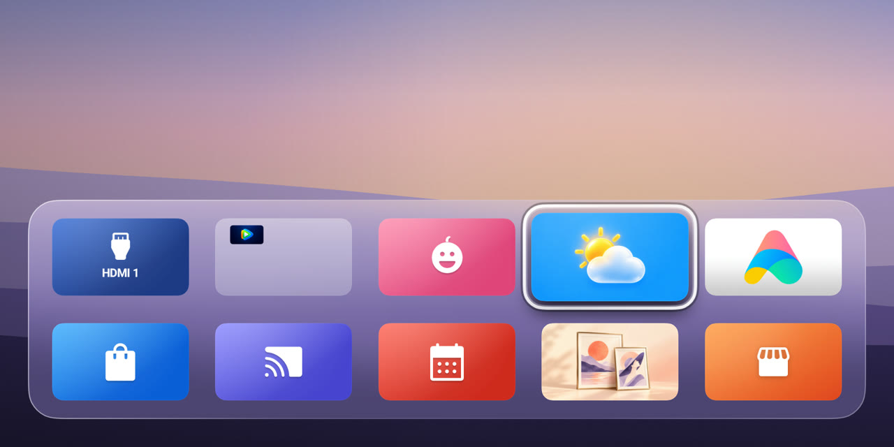
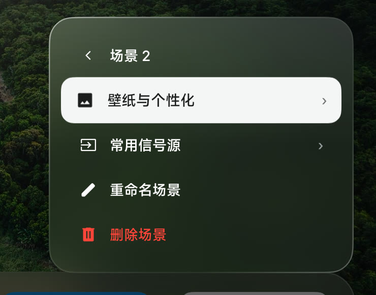
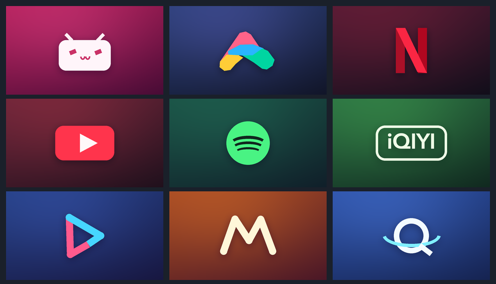

# NookScreen

**A TV home screen you can arrange with your remote.**

NookScreen is an open-source Android TV launcher based on [Aerial](https://github.com/pengchujin/aerial-tv). Keep apps, inputs, and wallpaper together and switch layouts for movies, games, or everyday use.

[Download the daily APK](https://github.com/Vanlee0129/nookscreen/releases/latest/download/nookscreen-daily.apk) · [Releases](https://github.com/Vanlee0129/nookscreen/releases) · [Issues](https://github.com/Vanlee0129/nookscreen/issues) · [中文](README.md)

## Install

1. Download `nookscreen-daily.apk` and install it on your Android TV. The package is `app.nookscreen.tv`.
2. Open NookScreen and choose it as the default Home app in Android settings. If the TV offers no default Home setting, use **Control Center → Make NookScreen Your Home Screen** to enable Home Guard.
3. On Home, press **Up** to focus the status button, then press **OK** to open Control Center. Hold **OK** on an app tile to move it, hide it, or put it in a folder.

## Desktop scenes

Open **Control Center → Desktop scenes** and duplicate the current layout. Set a wallpaper and favorite inputs for the new scene. Each scene saves its own app order, folders and hidden apps, and the active scene returns after a restart. Press **OK** on an input tile to open that input.

| Example scene | Scene settings |
| :-- | :-- |
|  |  |

## Artwork and wallpaper

NookScreen includes 16:9 HD tiles for popular apps. Open **Personalize** and scan the phone setup code to upload wallpaper, videos, or custom artwork. Uploaded artwork takes priority.

## Updates

Open **Control Center → NookScreen** to check for releases. On Android 12 and later, enable **Automatic updates** and allow NookScreen to install apps. NookScreen attempts to install a newer signed build while Home is idle. Use the update panel to install when Android asks for confirmation.

## Development and feedback

Use JDK 17 and Android SDK 36, then run `./gradlew :app:assembleDailyRelease`. See the [release guide](docs/RELEASE.md). When opening an issue, include the TV model, Android version, and steps to reproduce.

Released under the [MIT license](LICENSE).
