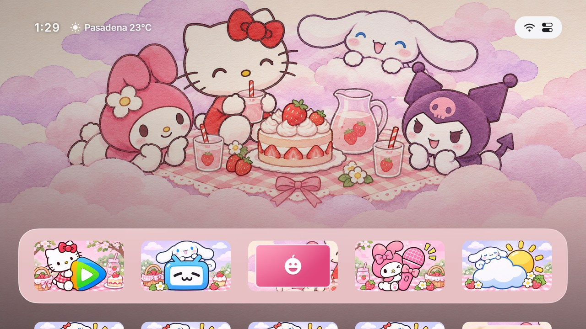
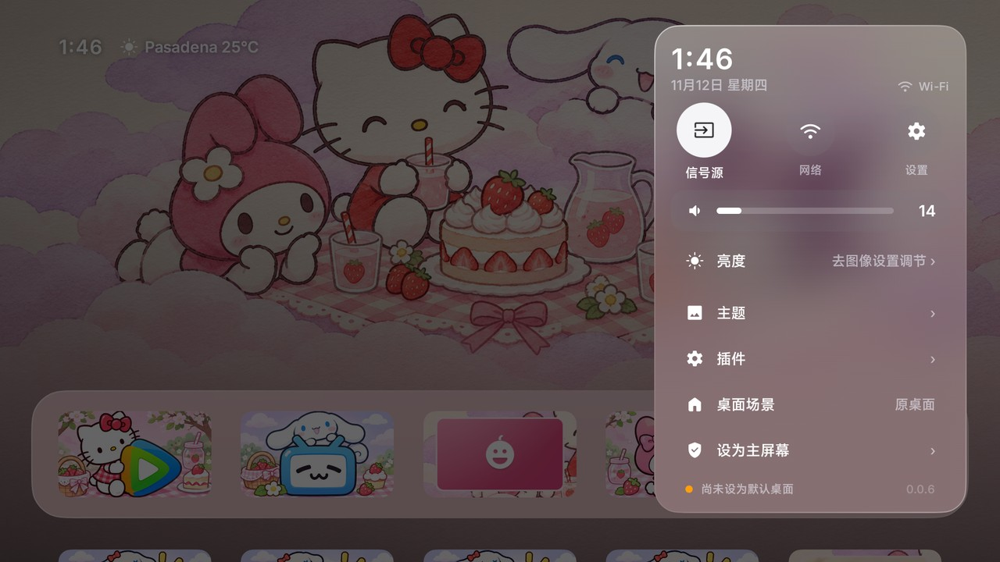
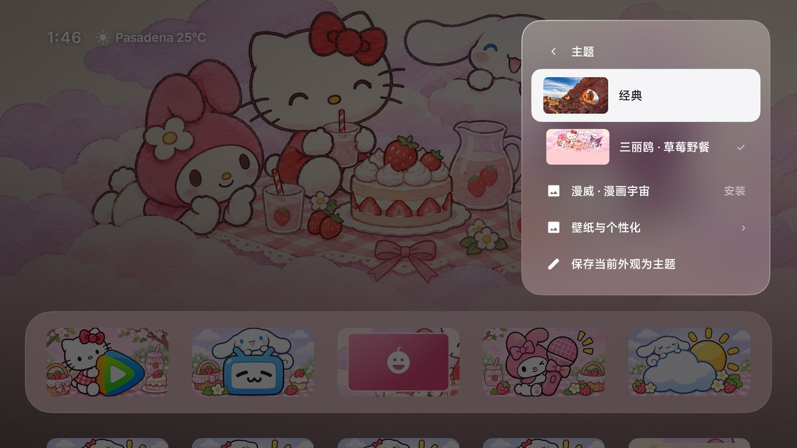
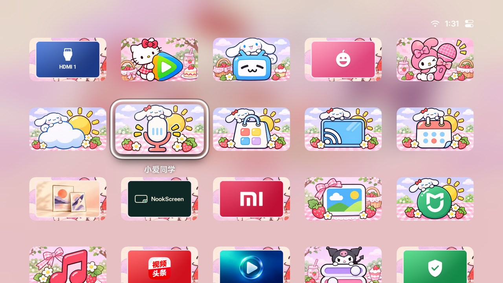
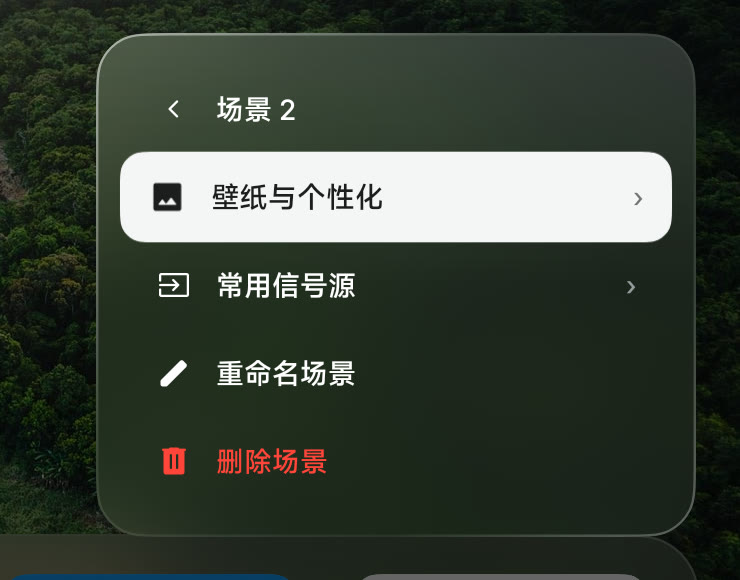
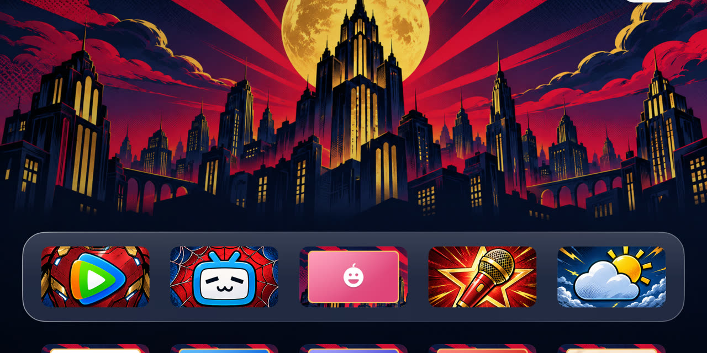

<div align="center">
  
  <h1>栖屏 NookScreen</h1>
  <p><strong>给你的电视，换个首页。</strong></p>
  <p>栖屏是一款开源的 Android TV 桌面。用遥控器整理应用、切换 HDMI 信号源、换壁纸，也能为日常看电视、观影和游戏分别保存布局。</p>
  <p>
    <a href="https://vanlee0129.github.io/nookscreen/">官网</a> |
    <a href="https://github.com/Vanlee0129/nookscreen/releases/latest/download/nookscreen-daily.apk"><strong>下载电视安装包</strong></a> |
    <a href="#安装">安装指南</a> |
    <a href="#电视首页能做什么">功能与操作</a> |
    <a href="#主题与插件">主题</a> |
    <a href="https://github.com/Vanlee0129/nookscreen/releases/latest">版本记录</a> |
    <a href="README.en.md">English</a>
  </p>
  
</div>

## 电视首页能做什么

| 想做什么 | 从哪里开始 |
| --- | --- |
| 整理应用 | 长按磁贴上的 **确定** 键，可以移动、隐藏应用，或把应用放进文件夹。在个性化设置里可以找回隐藏的应用。 |
| 切换桌面布局 | 在「控制中心 → 桌面场景」复制当前场景。可以把视频应用集中在观影场景，把 HDMI 和游戏应用放进另一套场景。 |
| 把 HDMI 放到首页 | 在当前场景的「常用信号源」里选择电视支持的输入。它们会出现在首页，选中后按 **确定** 就能切换。 |
| 更换壁纸、时钟和布局 | 在「控制中心 → 主题 → 壁纸与个性化」选壁纸、单排或双排、每排应用数量，以及时钟的大小和位置。 |
| 用手机布置桌面 | 手机和电视连到同一局域网，扫「壁纸与个性化」里的二维码。可以上传照片和视频、换应用图标、拖动排序，也可以手动选天气城市。 |
| 设置屏保 | 在「壁纸与个性化 → 屏幕保护程序」选时钟、照片、航拍或[自己上传的视频](docs/SCREENSAVER_VIDEOS.md)，再设空闲多久开始。 |
| 给孩子或长辈用 | 在个性化设置里打开「儿童与长辈模式」，挑出要显示的应用。儿童模式还可以设每天的使用时间和休息提醒。 |

每套桌面场景会单独保存应用顺序、文件夹、隐藏项、常用信号源和外观。切换场景时会一起切换这些设置，重启后回到上次使用的场景。

### 遥控器怎么按

| 按键 | 操作 |
| --- | --- |
| 首页按 **↑**，再按 **确定** | 选中右上角的状态按钮后打开控制中心。 |
| 选中磁贴后长按 **确定** | 打开磁贴菜单，整理应用或移除固定的信号源。 |
| 首页第一排按 **返回** | 如果已开启这个快捷操作，会立即进入屏保。 |

### 界面实拍

下面是栖屏在小米电视上的界面。主题和插件都能从控制中心直接打开。

| 控制中心 | 主题 |
| --- | --- |
|  |  |

| 三丽鸥主题场景 | 场景设置 |
| --- | --- |
|  |  |

### 给游戏机留一套桌面

1. 打开「控制中心 → 桌面场景」，选「复制当前场景」，再把新场景命名为「游戏」。
2. 在新场景的「常用信号源」中选游戏机接入的 HDMI。回到首页，长按磁贴把它移到顺手的位置。
3. 想看电视时，在「桌面场景」选回原来的布局。游戏场景的 HDMI 和应用位置会保留下来。

## 安装

栖屏支持 **Android 5.0 及以上**，安装无需 root。正式版的包名是 `app.nookscreen.tv`。使用 Android 4.x 的设备可参考独立的 [Aerial Lite](docs/LITE.md)。

1. [下载电视安装包 `nookscreen-daily.apk`](https://github.com/Vanlee0129/nookscreen/releases/latest/download/nookscreen-daily.apk)，拷到 U 盘，再用电视的文件管理器打开安装。如果系统拦住安装，按提示允许从这个来源安装应用。
2. 从电视的应用列表打开栖屏。在首页按 **↑** 选中右上角的状态按钮，再按 **确定** 打开控制中心。
3. 在系统设置中选栖屏作为默认桌面，按遥控器的 **主页键** 验证。系统没有默认桌面入口，或主页键仍返回厂商桌面时，打开「控制中心 → 设为主屏幕」，按电视提示开启桌面守护。

### U 盘装不了时

让电脑和电视连到同一网络，按[各品牌开启 ADB 的说明](docs/devices/adb-by-brand.md)打开调试，再在电脑上运行下面的命令。把示例 IP 和端口换成电视上显示的地址。如果电视只提供无线调试配对，请先按说明配对。

```sh
adb connect 192.168.1.20:5555
adb install -r nookscreen-daily.apk
```

安装后从应用列表打开栖屏。如果主页键还是会回到原桌面，可以继续从应用列表打开栖屏，也可以查阅对应的[机型适配记录](docs/devices/)。

### 兼容性与恢复

先确认电视能装 Android APK，再看具体机型。不同固件对默认桌面、待机唤醒和 HDMI 的限制各不相同。以下机型笔记也收录了上游 Aerial 的历史测试，查看时请留意记录里的固件和应用版本。

| 遇到的情况 | 从哪里查 |
| --- | --- |
| 小米 / Redmi 的主页键或桌面守护行为与预期不同 | 按系统版本和产品型号查[小米 Android 6](docs/devices/xiaomi-android6.md)、[小米 MFTP0](docs/devices/xiaomi-mitv-mftp0.md)或[小米 MFTR0](docs/devices/xiaomi-mitv-mftr0.md)记录。 |
| TCL / 雷鸟没有默认桌面设置，或找不到 HDMI | 对照 [TCL MT5879](docs/devices/tcl-mt5879-cn.md)、[MT9655](docs/devices/tcl-mt9655-cn.md)和[其他机型记录](docs/devices/)。同品牌不同固件的能力可能不同。 |
| 想恢复电视原桌面 | 在系统设置中改回默认桌面。若开启过「桌面守护」，在无障碍设置中关闭栖屏的守护服务，再按主页键确认。 |

栖屏的 v0.0.6 验收在小米 MiTV-MFTR0 上使用独立 Preview 验证了三丽鸥和漫威的主题更新。其他机型的历史记录和使用限制可按型号查找。 [v0.0.6 发布说明](https://github.com/Vanlee0129/nookscreen/releases/tag/v0.0.6) · [全部机型笔记](docs/devices/)

## 主题与插件

首页、遥控器操作、场景和应用更新由 Core 负责。其他功能和内容通过插件提供。**主题也是插件**，可以单独安装、更新、停用和移除。在控制中心，换外观直接进「主题」，功能插件在「插件」里管理。

在电视上打开 **控制中心 → 主题**，选一套主题下载。装好后再次选中它，按「应用」。用手机设置时，在「壁纸与屏保 → 主题」里操作。

| 三丽鸥 · 草莓野餐 | 漫威 · 漫画宇宙 |
| --- | --- |
|  |  |

两套主题各有 25 张专属磁贴，包括小爱同学、日历、应用中心、无线投屏和米家。其余应用会保留原来的图标，换上主题边框。你上传或手动选过的图标会优先显示。[磁贴覆盖清单和素材说明](docs/themes.md)

想保存自己的外观，可以在主题页选择「保存当前外观为主题」，再用手机设置页换图标。同一套自定义主题可用于多个场景。

## 更新与排查

| 要做什么 | 操作 |
| --- | --- |
| 更新栖屏 | 在「控制中心 → 栖屏 NookScreen」选择「检查更新」。同包名、同签名的覆盖升级会保留场景、照片和自定义图标。Android 12 及以上可在授权后于空闲时自动更新。 |
| 更新主题 | 在主题的操作菜单选择「检查更新」。下载失败时，确认电视能访问 GitHub Releases 后重试。 |
| 从旧版本恢复主题 | 从 v0.0.2 升级后，重新安装原主题，之前用过它的场景就会恢复原来的主题。v0.0.3 要到「控制中心 → 主题 → 插件」下载。 |

### 常见问题

- **装好了，按主页键怎么还是原来的桌面？** 安装完可以先从应用列表打开栖屏。要把主页键切过来，需要在系统设置里选择默认桌面，或按「控制中心 → 设为主屏幕」里的指引开启桌面守护。具体看这台电视的固件支持哪种方式。
- **手机扫了码，设置页打不开？** 确认手机和电视连在同一局域网，电视保持开机。也可以把电视上显示的地址输到同一网络里的电脑浏览器。
- **换了主题，为什么有些应用还是原图标？** 主题只给清单里的应用提供专属图标，其他应用保留原图案并换边框。你手动选的图标会优先显示。 [查看覆盖清单](docs/themes.md)

## 文档与反馈

| 我想了解 | 看这里 |
| --- | --- |
| 我的电视能不能设默认桌面、用 HDMI | [机型笔记](docs/devices/) · [各品牌开启 ADB 的位置](docs/devices/adb-by-brand.md) |
| 主题支持哪些应用、怎样做自己的主题包 | [主题图标清单](docs/themes.md) · [插件开发指南](docs/PLUGINS.md) |
| 怎样用自己拍的视频做屏保 | [视频屏保](docs/SCREENSAVER_VIDEOS.md) |
| 项目结构、真机测试和发布 | [架构](docs/ARCHITECTURE.md) · [真机检查](docs/HANDOFF.md) · [签名与发布](docs/RELEASE.md) |

遇到问题，请附上电视型号、Android 和栖屏版本、复现步骤。与主题或插件相关时，也请注明名称和版本。 [报告问题](https://github.com/Vanlee0129/nookscreen/issues/new?template=bug.yml) · [反馈机型适配](https://github.com/Vanlee0129/nookscreen/issues/new?template=device.yml) · [分享实测结果](https://github.com/Vanlee0129/nookscreen/issues/new?template=works.yml) · [提功能建议](https://github.com/Vanlee0129/nookscreen/issues/new?template=feature.yml)

## 开发与贡献

需要 **JDK 17** 和 **Android SDK 36**。在仓库根目录运行：

```sh
./gradlew :core:testDailyDebugUnitTest :core:assemblePreviewRelease
./gradlew :core:assembleDailyRelease
./gradlew :plugins:themes:assemble
```

| 目录 | 内容 |
| --- | --- |
| [`core/`](core/) | 桌面、场景、控制中心和手机设置页 |
| [`plugin-api/`](plugin-api/) | 插件兼容版本和 Android 扩展入口 |
| [`plugins/`](plugins/) | 主题资源、独立打包任务和时钟功能插件示例 |
| [`website/`](website/) | GitHub Pages 的中英文官网源码 |

Preview 的包名是 `app.nookscreen.tv.preview`，可以和正式版装在同一台电视上，方便测试。正式版 APK 在 `core/build/outputs/apk/daily/release/`，主题包在 `plugins/themes/build/distributions/`。更多细节见[架构](docs/ARCHITECTURE.md)、[插件开发](docs/PLUGINS.md)和[签名与发布](docs/RELEASE.md)。

预览官网可运行 `bash tools/build-website.sh <输出目录>`，再用本地 HTTP 服务打开该目录。GitHub Pages 从 `gh-pages` 分支根目录发布构建结果。

栖屏基于 [Aerial](https://github.com/pengchujin/aerial-tv)，使用 [MIT 许可证](LICENSE)。
