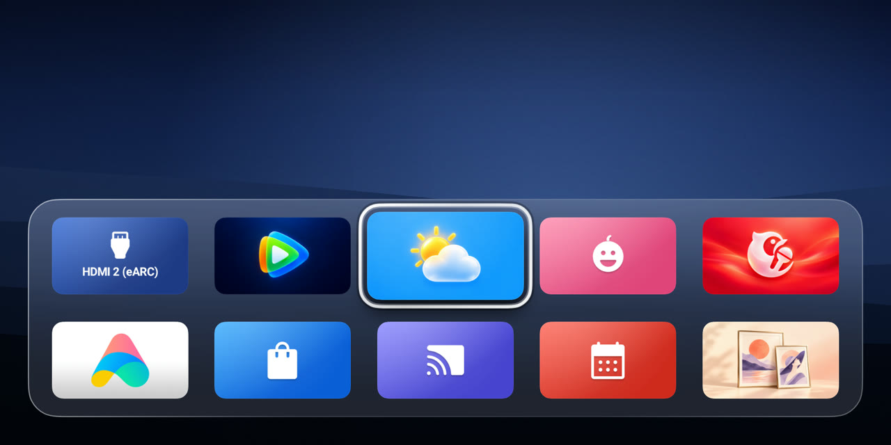
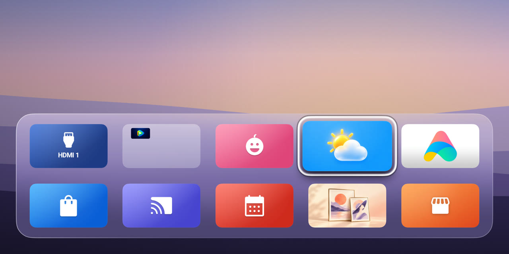

# 栖屏 NookScreen

**用遥控器布置你的电视首页。**

栖屏是基于 [Aerial](https://github.com/pengchujin/aerial-tv) 的开源 Android TV 桌面。把常用应用、信号源和壁纸放在同一个首页，按观影、游戏或日常使用切换。

[下载日用版 APK](https://github.com/Vanlee0129/nookscreen/releases/latest/download/nookscreen-daily.apk) · [版本记录](https://github.com/Vanlee0129/nookscreen/releases) · [反馈问题](https://github.com/Vanlee0129/nookscreen/issues) · [English](README.en.md)

## 安装

1. 下载 `nookscreen-daily.apk`，传到 Android TV 并安装。正式包名为 `app.nookscreen.tv`。
2. 打开栖屏，在电视的系统设置中设为默认桌面。没有默认桌面选项的电视，可在栖屏「控制中心 → 设为主屏幕」按提示开启桌面守护。
3. 回到首页，按 **↑** 聚焦右上角状态按钮，再按 **确定** 打开控制中心。长按应用磁贴可以移动、隐藏或放进文件夹。

## 桌面场景

从「控制中心 → 桌面场景」复制当前桌面，再为新场景挑选壁纸和常用信号源。应用顺序、文件夹和隐藏项随场景保存，重启后恢复上次使用的场景。常用信号源会成为桌面磁贴，按 **确定** 才会打开对应输入。

| 场景示例 | 场景编辑 |
| :-- | :-- |
|  |  |

## 主题

经典外观随 Core 安装。从「控制中心 → 主题 → 插件」安装三丽鸥草莓野餐、漫威漫画宇宙或导入主题 ZIP，再回到「主题」预览并应用。也可以扫描手机设置二维码，在「更多 → 插件」上传 ZIP、应用或移除主题。壁纸和应用磁贴一起切换，每个场景都会记住自己的主题。

想自己搭配时，先选底包和壁纸，再选「保存当前外观为主题」。保存后，从「壁纸与个性化」扫描设置二维码，在手机上为各个应用上传该主题的专属图标。自定义主题可以在多个场景中使用。

两套主题各提供 20 张常见应用专属磁贴，覆盖国内外影视、音乐、本地播放和系统工具。其他应用会用原有图案搭配主题边框。你上传的图标和明确选定的图标优先。

| 三丽鸥 · 草莓野餐 | 漫威 · 漫画宇宙 |
| :-- | :-- |
|  |  |

[查看主题覆盖清单与素材说明](docs/themes.md)

## 更新

在「控制中心 → 栖屏 NookScreen」检查更新。Android 12 及以上可开启「自动更新」，授权栖屏安装应用后，桌面空闲时会尝试安装已发布的同签名版本。系统要求确认时，可在更新页面手动安装。

主题包通过插件页独立安装和更新。升级自 v0.0.2 时，安装原主题包即可恢复场景中保留的引用。

## 开发与反馈

使用 JDK 17 和 Android SDK 36，运行 `./gradlew :core:assembleDailyRelease` 构建日用版。主题 ZIP 用 `./gradlew :plugins:themes:assemble` 独立构建。Core、插件接口、主题包和时钟示例分别位于 `core/`、`plugin-api/`、`plugins/themes/` 和 `plugins/clock/`。详见[插件开发指南](docs/PLUGINS.md)和[发布说明](docs/RELEASE.md)。反馈时请附上电视型号、系统版本和复现步骤。

项目采用 [MIT 许可证](LICENSE)。
